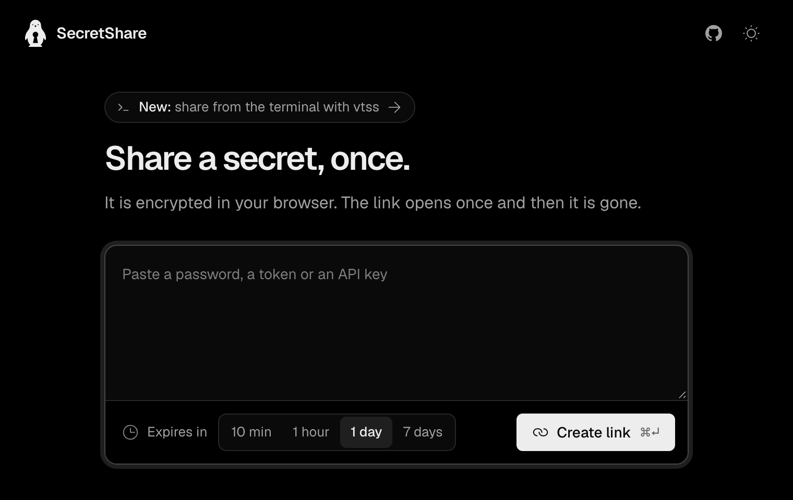

# VT-SecretShare

Zero-knowledge **one-time secret sharing**, self-hosted. Paste a password / token /
API key → get a link that works **once** and then self-destructs. Built around two
Redis commands, with a calm web UI and a command line client (`vtss`) for
scripts and agents.

> `.env` no es seguridad. - VT Security



Create a secret, copy the link, open it once, then open the same link again: the
server already deleted it. Recorded against a local instance with a fake secret.

## Why it's actually secure (the demo-worthy part)

- **Zero-knowledge.** The secret is encrypted **in your browser** with a random
  AES-256-GCM key (WebCrypto). Only the ciphertext is sent to the server.
- **The key never touches the server.** It lives in the URL `#fragment`, which
  browsers never send in requests. `Referrer-Policy: no-referrer` stops it leaking.
- **Only its own scripts run.** Any script on the view page could read the key,
  so a strict Content-Security-Policy (`script-src 'self'`, no inline code, no
  CDN) keeps injected markup from running. See [Security headers](#security-headers).
- **One read, then gone.** The first reveal runs one Redis Lua script that reads
  and deletes atomically. Two people racing the same link can never both win.
- **A wrong key doesn't burn it.** The browser derives a *verifier* from the key
  (HKDF-SHA256, a separate output that reveals nothing about the key) and sends
  only its SHA-256 on create. A reveal must present the verifier; the same Lua
  script compares it before deleting, so a truncated or mistyped link gets
  `403 wrong_key` and the secret stays. Secrets created without a verifier (old
  clients, `curl`) keep the original burn-on-first-reveal behaviour.
- **The key leaves the address bar.** The view page reads the `#key` once, then
  `history.replaceState` removes it, so the (synced) history entry never holds a
  usable link while the secret is alive. A reload before revealing reads it back
  from that tab's `sessionStorage`, which is not synced and dies with the tab.
  Best effort: a browser may already have recorded the original URL.
- **Nothing to steal at rest.** Redis only ever holds ciphertext, with a hard TTL.
  Dump Redis, read the logs, inspect server memory - there is no plaintext and no key.

So the entire server is basically: `SET key v1:<verifier hash>:<ciphertext> NX EX
<ttl>` on create, and one Lua script (`GET`, compare the verifier hash, `DEL`) on
read. That's the whole persistence model. Redis is doing the security-relevant
work (atomic check-and-burn + TTL expiry), which makes it a clean story for a
video.

## CLI

`vtss` does from the terminal what the page does in the browser: it encrypts on
your machine, stores only the ciphertext and prints the link. A link made by
either one opens in the other.

```bash
curl -fsSL https://secretshare.valentorassa.com/install.sh | sh
# or, with Go installed:
go install github.com/ValentinTorassa/VT-SecretShare/cmd/vtss@latest
```

The installer downloads the binary for your machine (Linux and macOS, amd64 and
arm64) from this repository's releases, checks its SHA-256 against the
release's `checksums.txt` and puts it in `~/.local/bin`. Nothing runs as root.
Releases carry the binaries from v1.1.0 on; a Windows build is attached too.

```bash
echo "s3cr3t" | vtss                 # prints https://…/s/<id>#<key>
vtss < .env                          # a whole file
vtss                                 # asks for it, input hidden
vtss --ttl 10m --copy                # lives 10 minutes; link copied to the clipboard
vtss open 'https://…/s/<id>#<key>'   # prints the secret and deletes it from the server
vtss open '<link>' -o .env           # writes it to a file (mode 0600) instead
vtss status '<link>'                 # "unopened: expires in 1 day", without opening it
```

- **Made to be piped.** The link (or the secret) is the only thing on stdout.
  What is said to a person goes to stderr, and only when a terminal is attached.
  `--json` gives `{"url","id","expires_at","ttl_seconds"}` on send and
  `{"secret"}` on open.
- **The secret is read from stdin, never from the arguments**, so it does not
  end up in the shell history or the process list. One trailing newline (the
  one `echo` adds) is dropped.
- **`open` cannot lose the secret to a bad path.** With `-o` the file is opened
  before the request, so an unwritable path fails while the secret still
  exists, and a link that is already gone leaves an existing file untouched.
- **Your own instance:** `--server https://secretshare.example.com` or
  `VTSS_SERVER`. `open` and `status` take the server from the link.
- **`--ttl`** takes `10m`, `1h`, `1d`, `7d` (default `1d`); the server applies
  its own limits.

| Exit code | Meaning |
| --- | --- |
| `0` | done |
| `1` | network, server or file error |
| `2` | wrong usage |
| `3` | the secret is gone: already opened, expired, or a wrong link |
| `4` | the key in the link does not match; the secret is intact |
| `5` | rate limited or store down; nothing was opened, try later |

### Agents

An agent that can run shell commands uses `vtss` as it is. These lines in its
instructions (`AGENTS.md`, `CLAUDE.md`, a skill) cover the two cases that
matter:

```markdown
## Secrets
- To give a person a secret, never paste it in the chat. Run
  `printf %s "$VALUE" | vtss` and send the link it prints. It opens once.
- To receive one, ask for a VT-SecretShare link and run
  `vtss open '<link>' -o <file>`. The secret goes to the file (mode 0600) and
  never appears in the conversation.
- Exit code 3: the link was already used or expired, ask for a new one.
  4 or 5: the secret is still there (wrong link, or try again later).
```

## Architecture

```
browser ──(AES-256-GCM encrypt)──▶ ciphertext ──POST──▶ Go ──SET..EX──▶ Redis
share link = /s/{id}#{key}  (the key is the fragment; no query string)

browser ──POST {verifier}──▶ Go ──Lua: GET, compare, DEL──▶ Redis ──ciphertext──▶ browser ──(decrypt with #key)──▶ secret
                         ▲ the verifier is checked and the value deleted in the same atomic step
```

- `main.go` - HTTP API + embedded static UI (`go:embed`). Tiny.
- `headers.go` - security headers on every response, and the asset version.
- `store.go` - the only thing that talks to Redis (`SetNX`, the check-and-burn
  script, `TTL`, plus the atomic rate-limit counter script).
- `ratelimit.go` - per-client rate limiting and client-IP resolution.
- `web/` - UI: `index.html` + `index.js` (create), `view.html` + `view.js`
  (reveal), `crypto.js` (WebCrypto), `ui.js` (page state, copy feedback),
  `i18n.js` (ES/EN), `theme.js` (black/light), `clipboard.js`, `app.css`. No
  inline scripts or styles: the CSP would block them. The logo and the icons
  are inline SVG in the HTML; `icon.svg`, `icon-32.png` and `icon-180.png` are
  the favicons and `og.png` is the card shown where a link is pasted.
- `web/fonts/` - Geist and Geist Mono (SIL Open Font License, see
  `web/fonts/LICENSE.txt`), vendored **on purpose**: a secrets tool shouldn't
  pull anything from a third-party CDN that could watch its users. The icons
  come from Lucide (ISC) and the GitHub mark from Octicons (MIT); see
  [THIRD_PARTY_NOTICES.md](THIRD_PARTY_NOTICES.md).
- `internal/secretshare/` - the client for programs that are not a browser: the
  same encryption as `web/crypto.js` plus the three API calls.
- `cmd/vtss/` - the command line client. See [CLI](#cli).
- `install.sh` - installs `vtss`; the server also serves it at `/install.sh`.

### Theme & language

- **One interface, black by default.** The toggle in the header switches to
  light and the choice persists. (The Hacker and Pro modes of 1.0 are gone; a
  `?theme=` left in an old link is ignored.)
- **Spanish or English** follows the browser (Spanish for `es-*`, English for
  everything else); the switch in the footer pins one. Links carry no
  preferences, so each person reads the page in their own language. `?lang=`
  from an old link is still honoured.
- Every page is one of a few named states (`data-state` on `<main>`): the
  create page is `compose` or `done`; the view page is `checking`, `ready`,
  `revealed`, or a dead end that says what happened (`gone`, `badlink`,
  `wrongkey`, `undecryptable`).

## Run it (local dev)

```bash
./run.sh        # starts a disposable Redis (docker) + the app on :8080
# then open http://localhost:8080
```

Or manually:

```bash
docker run -d --name vt-redis-dev -p 127.0.0.1:6379:6379 redis:7-alpine --save "" --appendonly no
go run .
```

## Run it (compose)

```bash
docker compose up --build      # or: podman compose up --build
```

Behind a VPN or reverse proxy, set `BASE_URL` so the generated links point at the
reachable host:

```bash
APP_PORT=8081 BASE_URL=https://secretshare.example.com docker compose up --build
```

Remote deployments must use HTTPS because browser WebCrypto is unavailable on
insecure origins (except `localhost`).

### How the live instance runs

secretshare.valentorassa.com is not the compose setup: it is the Go binary
under a systemd unit (tracked in the private infra repo) on the same host as
`cloudflared`, which forwards to `localhost:8081`. That is why the default
`TRUSTED_PROXY_CIDRS` is loopback only, and why the app listens on
`127.0.0.1` unless `BIND_ADDR` says otherwise: nothing on the LAN or tailnet
needs the plain-HTTP port. The server drops clients that stall (5 s for
headers, 15 s to read a request, 30 s to write a response, 120 s idle). To update it: pull, `go test ./...`,
build to a new file, smoke-test it on a spare port (`/healthz` → 200,
`/api/secret/x/meta` → 404, which also exercises the rate-limit script, and
`curl -sI /` carries the `Content-Security-Policy`), keep
the previous binary for rollback, swap, restart the unit. Keep
`RATE_LIMIT_SALT` in a root-owned `0600` EnvironmentFile, never in the unit.

## Config (env)

| Var | Default | Meaning |
| --- | --- | --- |
| `BIND_ADDR` | `127.0.0.1` | listen address; loopback because `cloudflared` (or your proxy) is the only client. The container image sets `0.0.0.0` |
| `PORT` | `8080` | listen port |
| `APP_PORT` | `8080` | host port published by Docker Compose |
| `REDIS_ADDR` | `127.0.0.1:6379` | redis address |
| `REDIS_PASSWORD` | _(empty)_ | redis auth |
| `BASE_URL` | `http://localhost:$PORT` | used to build share links |
| `DEFAULT_TTL_SECONDS` | `86400` | default lifetime |
| `MAX_TTL_SECONDS` | `604800` | TTL ceiling |
| `MAX_CIPHERTEXT_BYTES` | `262144` | max blob size |
| `RATE_LIMIT_CREATE` | `20` | creates allowed per client per window (`0` disables) |
| `RATE_LIMIT_CREATE_WINDOW_SECONDS` | `600` | create window |
| `RATE_LIMIT_READ` | `30` | reveal + meta requests allowed per client per window (`0` disables) |
| `RATE_LIMIT_READ_WINDOW_SECONDS` | `600` | read window |
| `RATE_LIMIT_SALT` | _(random per process)_ | HMAC key for counter keys; set it so counters survive restarts and are shared across instances |
| `TRUSTED_PROXY_CIDRS` | `127.0.0.0/8,::1/128` | peers whose `CF-Connecting-IP` header is believed |

## API

| Method | Path | Notes |
| --- | --- | --- |
| `POST` | `/api/secret` | body `{ciphertext, ttl_seconds?, verifier_hash?}` → `{id, share_url, ttl_seconds, expires_at}`; create limit |
| `POST` | `/api/secret/{id}/reveal` | header `X-VT-Reveal: 1`, body `{verifier}` (empty for secrets without one); **burns** it → `{ciphertext}`, `403 {"code":"wrong_key"}` (secret kept) or 404; read limit |
| `GET` | `/api/secret/{id}/meta` | TTL/alive without burning; the view page calls it on load to show the expiry or say the link is dead; read limit |
| `GET` | `/healthz` | `200 {"status":"ok"}` if Redis answers `PING` within 1 s, else `503`; not rate limited |
| `GET` | `/install.sh` | the `vtss` installer, as plain text; not rate limited |

Over a limit the API answers `429` with `Retry-After` (seconds until the window
resets) and `{"error":"too many requests - try again in N seconds"}`.

## Rate limiting

- **Per client, counted in Redis.** A fixed window per client: one Lua script does
  `INCR` and, on the first hit, `PEXPIRE`, so the pair is atomic and a counter can
  never be left without a TTL. Counters live in Redis, not in process memory.
- **Two budgets.** Creating (`POST /api/secret`) and reading (`reveal` and `meta`)
  are counted separately. Reading is the guessing surface: `meta` is an existence
  oracle and `reveal` burns. The limiter runs before the burn script, so a
  rejected reveal never burns the secret.
- **When Redis is down.** The create limiter **fails open** and logs: creating is
  not a guessing surface, and the `SET` that follows fails anyway. The read
  limiter **fails closed** with `503` + `Retry-After`: reads must not become
  silently unlimited, and refusing costs nothing because the secret lives in the
  same Redis.
- **Client IP.** `CF-Connecting-IP` is used only when the TCP peer is in
  `TRUSTED_PROXY_CIDRS` (loopback by default, where `cloudflared` connects from).
  From any other peer the header is ignored and the socket address is used, so a
  direct LAN/tailnet connection cannot choose its own bucket. `X-Forwarded-For`
  is never read. IPv6 clients are grouped per `/64`.
- **No raw IPs at rest.** Counter keys are `ratelimit:{create|read}:` plus an
  HMAC-SHA256 of the client bucket under `RATE_LIMIT_SALT`, and they expire with
  their window (10 minutes by default). Client IPs are never logged. Without
  `RATE_LIMIT_SALT` a random salt is generated at start-up: counters then reset on
  restart and are not shared between instances. Generate one with
  `openssl rand -hex 32` and keep it out of git.
- **Behind Docker port publishing** the app sees the bridge gateway (for example
  `172.17.0.1`), not loopback, for connections from the host. Every client then
  shares one bucket unless you add that gateway to `TRUSTED_PROXY_CIDRS`. Only do
  that if nothing else can reach the container directly.

## Security headers

Every response (pages, API, static files, errors) carries:

| Header | Value | Why |
| --- | --- | --- |
| `Content-Security-Policy` | `default-src 'none'; script-src 'self'; style-src 'self'; img-src 'self'; font-src 'self'; connect-src 'self'; base-uri 'none'; form-action 'self'; frame-ancestors 'none'; require-trusted-types-for 'script'; trusted-types 'none'` | the key is in the page URL, so only this origin's own files run: no inline scripts, styles or event handlers, no `eval`, no CDN; Chromium also rejects any string assigned to an HTML sink, and no Trusted Types policy can be created to get around that |
| `Referrer-Policy` | `no-referrer` | never send the page URL anywhere |
| `X-Frame-Options` | `DENY` | `frame-ancestors 'none'` for older browsers |
| `X-Content-Type-Options` | `nosniff` | no MIME sniffing |
| `Permissions-Policy` | camera, microphone, geolocation, payment, USB, ... `=()`; `clipboard-write=(self)` | the copy buttons are the only feature the UI uses |
| `Cross-Origin-Opener-Policy` | `same-origin` | the page that opened a link gets no handle on it |
| `Cross-Origin-Resource-Policy` | `same-origin` | other sites cannot embed these responses |
| `Strict-Transport-Security` | `max-age=31536000` | browsers ignore it over plain HTTP (localhost), and remote deployments are HTTPS anyway because WebCrypto needs it; no `includeSubDomains` or `preload` |

`headers_test.go` checks them on every kind of route, and fails if a page gains
an inline `<script>`, `<style>`, `style=` or `on*=` attribute, or if a script
under `web/` uses an HTML sink (`innerHTML`, `outerHTML`, `insertAdjacentHTML`,
`document.write`, ...). Localized rich text is built from a fixed allowlist of
elements (`b`, `span`, `br`) with no attributes.

`POST /api/secret` only accepts `Content-Type: application/json` (415
otherwise), so a cross-site form or a `text/plain` "simple" request cannot
create secrets without a CORS preflight, which the server never grants.

`/web/` files are served `immutable` for a year, and browsers and the Cloudflare
edge keep them, so the pages load them as `/web/<file>?v=<hash of web/>`
(computed at start-up). Any change under `web/` changes every asset URL. The
fonts and the images are not versioned: give them a new file name if you ever
replace them.

## Notes / hardening ideas

- Reveal is gated behind an explicit button click so link-preview crawlers
  (Slack/Discord/WhatsApp) can't burn the secret before the human sees it.
- The container runs Redis with persistence off (`--save "" --appendonly no`) so
  secrets never hit disk.
- Possible next steps: optional passphrase (extra PBKDF2 layer), a `/metrics`
  endpoint. Trusted Types (`require-trusted-types-for 'script'` plus
  `trusted-types 'none'`) is enabled; localized rich text is assembled with DOM
  nodes rather than `innerHTML`.

## Verificación de regresiones - 2026-09-14

```bash
go test -race ./...
go build ./...
node --test tests/*.test.mjs
```

Redis 6.2+ debe estar disponible como `redis-server`. Cada test inicia una instancia efímera sin persistencia y con socket privado; nunca usa Redis de producción. Se verifican carrera de una lectura, expiración, colisiones y cifrado WebCrypto.

## License

[Apache License 2.0](LICENSE). Copyright 2026 Valentín Torassa.
